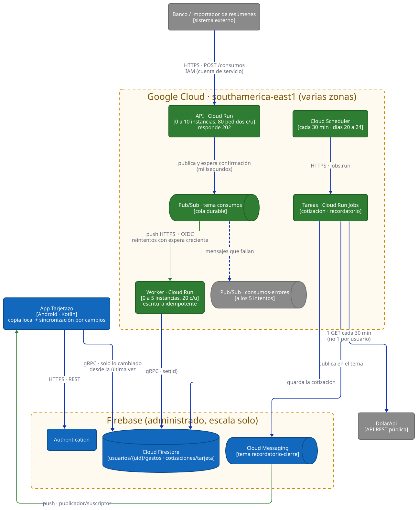

# Trabajo Práctico 3 — Estrategias de escalabilidad

**Cátedra:** Arquitecturas Móviles — UTN Facultad Regional San Francisco
**Profesor:** Ing. Juan Pablo Bono
**Alumnos:** Martiniano Gimenez, Fabricio Quinteros
**Aplicación:** Tarjetazo — gastos de una tarjeta de crédito compartida
**Repositorio:** <https://github.com/FabriQuinteros/tp1-arquitecturas-moviles> (rama `feat/tp3-escalabilidad`)

---

## 1. Dónde se rompe Tarjetazo al crecer

Para escalar no importa cuántos usuarios tiene la app, sino cuántos la usan al mismo tiempo.
En una tarjeta de crédito ese número no es parejo: el uso se concentra en los días previos al
cierre, cuando todos los titulares revisan y dividen sus gastos. Hay que dimensionar para ese
pico y no pagar por él el resto del mes.

| Desafío | Cómo aparece en Tarjetazo |
|---|---|
| Picos previsibles | Los días de cierre concentran la carga de consumos y las aperturas de la app. |
| Procesamiento lento en el camino del usuario | Convertir un consumo puede depender de un servicio externo. Si el cliente espera a que termine, cualquier demora se convierte en demora de todos. |
| Datos que viajan de más | La app descargaba todos los gastos en cada apertura: el tráfico y el costo de Firestore, que cobra por documento leído, crecían con usuarios × gastos × aperturas. |
| Dependencia externa multiplicada | Cada consumo en dólares consultaba DolarApi desde el teléfono: una llamada por usuario para obtener el mismo dato. |
| Trabajo manual | Publicar el recordatorio de cierre desde la consola depende de que alguien se acuerde. Lo que requiere atención de una persona no escala. |

## 2. Estrategia

La idea central es **dejar la app lista para escalar sin escalarla todavía**. La hipótesis del
producto recién se está validando, así que pagar capacidad hoy sería un desperdicio; lo que no
puede faltar es poder responder rápido si el uso crece. Por eso casi todo el diseño arranca en
cero instancias y crece solo.

La app sigue siendo liviana y escribe directo en Firestore. El backend nuevo atiende lo que no
debe hacer el teléfono: recibir consumos cargados en forma automática (por ejemplo, un importador
de resúmenes) y correr las tareas programadas.

| Aspecto | Decisión |
|---|---|
| **Desacople con cola** | La API publica el consumo en Pub/Sub y responde `202` sin esperar el procesamiento. Un worker aparte lo procesa a su ritmo. La cola absorbe el pico y un consumo aceptado no se pierde aunque el worker esté caído. |
| **Balanceo de carga** | Cloud Run reparte los pedidos entre las instancias de cada servicio. No hay un balanceador que administrar. |
| **Autoescalado** | API de 0 a 10 instancias, con 80 pedidos simultáneos por instancia. Worker de 0 a 5, con 20. Sin tráfico no queda nada encendido. El tope del worker es más bajo a propósito: en un pico crece la cola, no la presión sobre Firestore. |
| **Redundancia** | Cloud Run distribuye las instancias entre las zonas de la región y Firestore replica los datos. Si un mensaje falla, Pub/Sub lo reintenta con espera creciente y, a los 5 intentos, lo pasa a una cola de errores para revisarlo sin frenar al resto. |
| **Entrega repetida** | Pub/Sub entrega cada mensaje al menos una vez. El worker escribe con el id del mensaje como clave, así que repetirlo pisa el mismo documento y no duplica el gasto. |
| **Menos datos por la red** | La app trae solo lo que cambió desde la última sincronización. Para que un borrado llegue a los otros teléfonos, los gastos se marcan como borrados en lugar de eliminarse. |
| **Una llamada para todos** | Una tarea programada consulta DolarApi cada 30 minutos y guarda el valor en Firestore. La app y el worker leen de ahí; sin conexión queda disponible el último valor. |
| **Automatización** | Cloud Scheduler dispara el recordatorio de cierre del 20 al 24 de cada mes, sin intervención de nadie. Una sola publicación en el tema de Cloud Messaging llega a todos los suscriptos. |
| **Región** | San Pablo (`southamerica-east1`), la más cercana a usuarios en Argentina. |
| **Costo** | El máximo de instancias es también el techo de gasto. Se suma un aviso de presupuesto al 50, 90 y 100 % de 10 dólares. |

**Cuándo mover estos números.** Las señales a seguir son los mensajes pendientes en la cola, la
latencia de la API y si las instancias llegan al tope durante el cierre. Si la cola tarda en
vaciarse más de lo que el usuario tolera ver un gasto sin aparecer, se sube el tope del worker;
si la API llega al tope, el suyo. Antes de subir cualquiera de los dos conviene mirar si el
problema es de capacidad o de diseño: como se ve en la prueba de carga, agregar instancias no
siempre es la respuesta.

## 3. Configuración en la nube

Toda la infraestructura está declarada como código en `infra/main.tf` (OpenTofu, compatible con
Terraform), de modo que se puede reproducir o cambiar sin pasos a mano:

```hcl
resource "google_cloud_run_v2_service" "api" {
  name     = "tarjetazo-api"
  location = var.region
  template {
    scaling {
      min_instance_count = 0    # sin tráfico no se paga nada
      max_instance_count = 10   # el tope es también un techo de gasto
    }
    max_instance_request_concurrency = 80   # antes de crear otra instancia
    ...
  }
}
```

| Recurso | Para qué |
|---|---|
| Cloud Run `tarjetazo-api` | Recibe consumos. Sin acceso público: solo llaman sistemas autorizados con su cuenta de servicio. |
| Cloud Run `tarjetazo-worker` | Procesa lo que entrega la cola, autenticado con OIDC. |
| Pub/Sub `consumos` y `consumos-errores` | Cola principal, con reintentos, y cola de lo que falló (retiene una semana). |
| Cloud Run Jobs y Cloud Scheduler | Cotización cada 30 minutos y recordatorio de cierre. |
| Cuentas de servicio | Una por pieza, con solo los permisos que necesita. |
| Presupuesto | Aviso por correo; no corta el servicio. |

Esta configuración **no se desplegó**: Cloud Run requiere una cuenta de facturación activa y, con
la hipótesis sin validar, no se justifica. Se verificó con `tofu validate`, que da la configuración
como válida; un `tofu plan` necesitaría credenciales del proyecto. Hasta que se despliegue, la tarea
de la cotización no corre en la nube y `cotizaciones/tarjeta` hay que cargarlo a mano para que
funcione la conversión de dólares en la app.

Para probar el comportamiento sin desplegar, `backend/docker-compose.yml` levanta una réplica local
de la misma arquitectura: el mismo código de la API y del worker, los emuladores oficiales de
Pub/Sub y Firestore, y un nginx en el papel del balanceador de Cloud Run. La cantidad de réplicas
se fija a mano con `--scale`, porque en local no existe el autoescalado.

## 4. Prueba de carga

Para encontrar los cuellos de botella antes que los usuarios se generó un pico con Locust: de 0 a 200 usuarios en 20 segundos, sostenido durante un minuto, cada uno mandando un
consumo cada 0,2 a 1 segundo. Se comparó la versión sincrónica, en la que el cliente espera todo
el procesamiento, contra la versión con cola, con 1 y con 3 réplicas. En ningún escenario hubo
pedidos fallidos. Los datos crudos están en `carga/resultados/`.

### 4.1 Procesamiento instantáneo

| Versión | Réplicas | Pedidos por segundo | Mediana | Percentil 95 |
|---|---|---|---|---|
| Sincrónica | 1 | 94 | 930 ms | 3.000 ms |
| Sincrónica | 3 | 149 | 450 ms | 1.100 ms |
| Con cola | 1 | 115 | 760 ms | 2.000 ms |
| Con cola | 3 | 115 | 690 ms | 1.500 ms |

Con un procesamiento que no tarda nada, la cola no aporta: agrega un paso más y la versión
sincrónica con 3 réplicas es la mejor. Además, triplicar las réplicas con cola casi no cambia nada.
Una primera corrida dio 108 y 95 pedidos por segundo, así que esas diferencias son ruido. La API no
era el límite (54 % de un núcleo con una réplica). Los 4 núcleos de la máquina se reparten entre el
generador de pedidos y los emuladores, que son uno solo por más réplicas que se agreguen.

### 4.2 Procesamiento que depende de algo lento

La cola existe para el caso en que procesar tarda, así que se repitió la prueba con una demora
simulada de 1 segundo por consumo, como la de un servicio externo lento.

| Versión | Réplicas | Pedidos por segundo | Mediana | Percentil 95 |
|---|---|---|---|---|
| Sincrónica | 1 | 36 | 4.500 ms | 4.700 ms |
| Sincrónica | 3 | 100 | 1.100 ms | 1.400 ms |
| Con cola | 1 | 207 | 180 ms | 680 ms |
| Con cola | 3 | 217 | 140 ms | 550 ms |

Acá sí se ve la diferencia. **Una sola réplica con cola atiende el doble de pedidos que tres réplicas
sin cola, y responde seis veces más rápido.** Agregar servidores mejora la versión sincrónica, pero
cambiar la arquitectura la supera con menos recursos: escalar no siempre es la respuesta correcta.

El costo de responder rápido es que el consumo no está procesado cuando el cliente recibe la
respuesta. Durante el pico la cola crece y se vacía después: en esta prueba el worker guardó 19,6
consumos por segundo, contra más de 200 que entraban, y a ese ritmo vaciar los 16.671 aceptados
lleva unos 14 minutos. Para un gasto importado de un resumen esa espera es aceptable; para algo que
el usuario está mirando en pantalla no lo sería, y por eso la carga manual desde la app no pasa por
la cola.

### 4.3 Qué no se pudo medir

- **El escalado del worker.** El ritmo de 19,6 por segundo fue idéntico con 1 y con 3 réplicas, y
  los workers estaban casi sin uso de CPU (3 % cada uno): el límite lo pone el emulador de Pub/Sub,
  que entrega unos 20 mensajes a la vez. En la nube, 5 instancias con 20 pedidos cada una admitirían
  100 mensajes simultáneos; ese número es un cálculo, no una medición.
- **El vaciado completo de la cola con demora.** Esos dos escenarios se cortaron a los 9 minutos, con
  la cola todavía en curso. En los escenarios sin demora, la cola sí se vació y los gastos guardados
  superaron a los pedidos contados (9.607 guardados contra 9.443): Locust no cuenta los que estaban
  en vuelo al terminar. No faltó ningún consumo.
- **El autoescalado real.** Las instancias que se crean y se apagan según la demanda, y el tiempo
  de arranque desde cero, solo se pueden medir con el backend desplegado.

## 5. Arquitectura actualizada



Diagrama de contenedores con la notación del modelo C4: en azul lo que ya existía, en verde lo
agregado para escalar y en gris los sistemas externos. Dentro de Google Cloud, cada servicio de
Cloud Run indica su rango de instancias. La flecha entre la cola y el worker es donde se absorbe el
pico: hacia arriba la entrada puede ser tan rápida como llegue la demanda, y hacia abajo el
procesamiento avanza al ritmo que se le fija.
