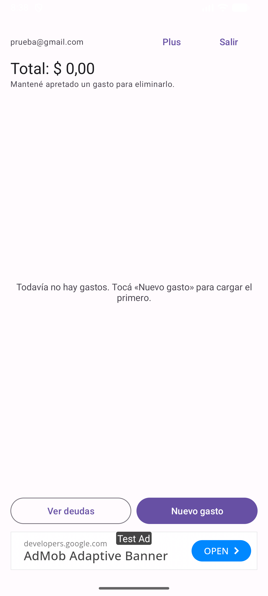
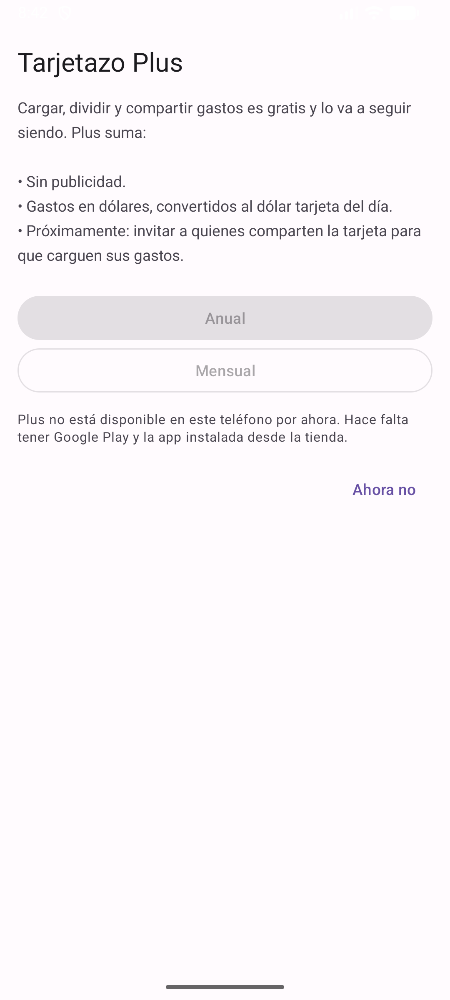
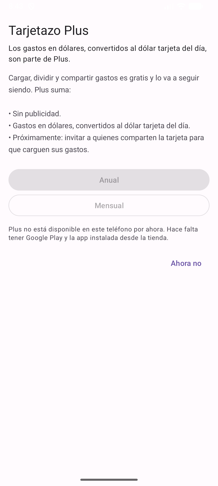
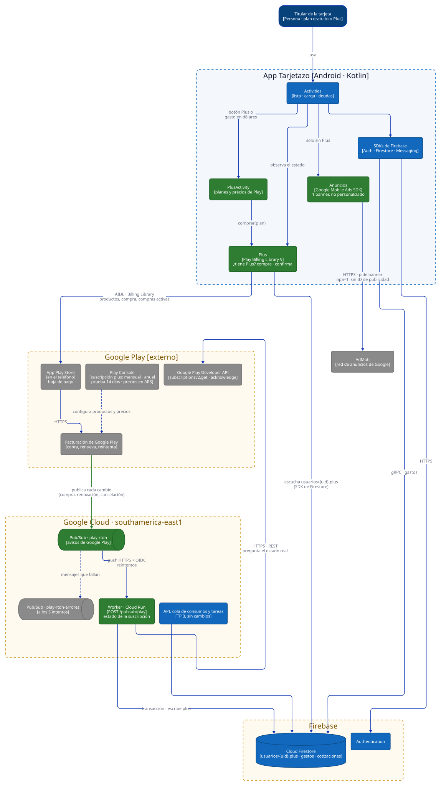

# Trabajo Práctico 4 — Monetización y estrategias de precios

**Cátedra:** Arquitecturas Móviles — UTN Facultad Regional San Francisco
**Profesor:** Ing. Juan Pablo Bono
**Alumnos:** Martiniano Gimenez, Fabricio Quinteros
**Aplicación:** Tarjetazo — gastos de una tarjeta de crédito compartida
**Repositorio:** <https://github.com/FabriQuinteros/tp1-arquitecturas-moviles> (rama `feat/tp4-monetizacion`)

---

## 1. Modelos de monetización y cuál le sirve a Tarjetazo

El modelo tiene que salir de cómo se usa la app. Tarjetazo la abre el titular varias veces por
mes, en momentos cortos (cargar un gasto en la caja), y lo que le resuelve es fin de mes:
saber cuánto le debe cada uno. Además, el MVP del TP 2 todavía está validando la hipótesis,
así que nada de lo que se cobre puede frenar la carga de gastos, que es justo lo que se mide.

| Modelo | Cómo sería en Tarjetazo | Decisión |
|---|---|---|
| **Pago por descarga** | Pagar para instalarla. | **No.** Es una barrera antes de que el usuario sepa si le sirve, y la hipótesis todavía no está validada. Además el titular invita a otros a mirar el resumen: si la app es paga, nadie la prueba. |
| **Publicidad** | Anuncios en las pantallas. | **Sí, acotada.** Monetiza al usuario que nunca va a pagar, pero rinde poco (el costo por mil impresiones en Argentina es bajo) y molesta. Además, una app que ve los gastos de la tarjeta no puede alimentar perfiles publicitarios. Un solo banner, no personalizado, fuera de la carga de gastos. |
| **Compras in-app únicas** | Pagar una vez por una función. | **No por ahora.** Los costos de Tarjetazo son recurrentes (Firestore, la tarea de la cotización cada 30 minutos, el backend del TP 3); un pago único no los cubre a largo plazo. |
| **Suscripción (freemium)** | Lo básico gratis, Plus por mes o por año. | **Sí, es el ingreso principal.** El ingreso recurrente acompaña a un costo recurrente, y el valor de Plus también es continuo: cada mes hay consumos en dólares. |
| **Venta de datos / afiliados** | Vender hábitos de consumo, recomendar tarjetas. | **No.** Rompe la confianza que necesita una app de gastos, y recomendar tarjetas a cambio de comisión le quita neutralidad. |

## 2. Estrategia: freemium con suscripción y publicidad mínima

### 2.1 Qué es gratis y qué es Plus

La regla es simple: **todo lo que valida la hipótesis queda gratis**. Plus cobra por lo que le
ahorra trabajo a quien más usa la app, y por lo que a Tarjetazo le cuesta mantener.

| Función | Gratis | Plus |
|---|---|---|
| Cargar, dividir y eliminar gastos | ✔ | ✔ |
| Ver deudas y compartir el resumen | ✔ | ✔ |
| Sincronización en la nube y recordatorio de cierre | ✔ | ✔ |
| Sin publicidad | — | ✔ |
| Gastos en dólares al dólar tarjeta del día (TP 7) | — | ✔ |
| Invitar colaboradores a la tarjeta (próxima versión) | — | ✔ |

Los gastos en dólares son el gancho natural: dependen de la tarea programada del TP 3, que
consulta la cotización cada 30 minutos, y los usa justo el titular que paga suscripciones en el
exterior. Invitar colaboradores, lo que la participante de la prueba del TP 2 llamó «centralizar los
gastos», es la funcionalidad que más se pidió y la que va a sostener la suscripción cuando esté.

### 2.2 Precios

| Plan | Precio en Argentina | Por qué |
|---|---|---|
| Mensual | $ 1.999 por mes | Menos que un café. Baja el riesgo de probar. |
| Anual | $ 14.999 por año | Doce meses del mensual son $ 23.988: el anual ahorra 37 %, unos cuatro meses gratis. Asegura el ingreso del año y reduce las bajas. La pantalla lo muestra primero. |
| Prueba gratis | 14 días, en los dos planes | Solo para quien nunca tuvo Plus. Alcanza para que pase un cierre de tarjeta y el usuario vea el valor. |

- Los precios **se cargan en Google Play Console, no en la app**: la pantalla los lee de Google
  Play con la moneda e impuestos de cada país. Con la inflación hay que actualizarlos seguido, y así
  no hace falta publicar otra versión. Google Play permite mantener el precio anterior a los que ya
  están suscriptos o avisarles el aumento.
- Google retiene el **15 %** de las suscripciones. El precio que ve el usuario incluye el IVA, que
  liquida Google.
- Precio de lanzamiento, no definitivo: se ajusta con lo que se mida (sección 2.4).

### 2.3 Cuánto puede dejar (supuestos para planificar)

Con 1.000 usuarios activos por mes, un 4 % que pasa a Plus (60 % mensual, 40 % anual) y 20
aperturas por mes de cada usuario gratuito:

| Fuente | Cálculo | Por mes |
|---|---|---|
| Suscripción mensual | 24 × $ 1.999 | $ 47.976 |
| Suscripción anual | 16 × $ 14.999 ÷ 12 | $ 19.999 |
| Neto de suscripciones | ($ 67.975 ÷ 1,21 de IVA) × 0,85 | **≈ $ 47.750** |
| Publicidad | 960 usuarios × 20 banners = 19.200 impresiones × US$ 0,20 cada mil | ≈ US$ 4 |

Dos conclusiones. La publicidad no paga la infraestructura (el presupuesto del TP 3 es de
US$ 10 por mes): su papel es recordarle al usuario gratuito que existe Plus, no financiar la app.
Y la variable que mueve el resultado es la conversión: pasar del 4 al 6 % suma más que triplicar
los anuncios.

### 2.4 Qué se mide

| Métrica | Para decidir |
|---|---|
| Usuarios que abren la pantalla Plus, y desde dónde (botón o gasto en dólares) | Si el gancho de los dólares funciona. |
| Conversión de prueba gratis a pago | Si 14 días alcanzan o conviene otra duración. |
| Bajas por mes y motivo (la encuesta de cancelación de Google Play) | Si el precio es el problema. |
| Ingreso promedio por usuario, gratis y Plus | Si la publicidad justifica la molestia. |

Google Play Console da conversión, bajas e ingresos por plan sin código extra. Para probar
precios, Play permite ofertas distintas por segmento sin publicar otra versión.

## 3. Implementación en la app

### 3.1 Dependencias

```kotlin
// app/build.gradle.kts
implementation(libs.billing)            // Google Play Billing Library 9.1.0
implementation(libs.play.services.ads)  // Google Mobile Ads SDK 25.5.0 (AdMob)
```

### 3.2 Compras con Google Play Billing — Plus.kt

Toda la facturación queda detrás de una sola clase, como cada dependencia externa desde el TP 7.
Las pantallas solo preguntan `Plus.activo` y se enteran de los cambios con `Plus.observar`.

```kotlin
// Abre la hoja de pago de Google Play para el plan elegido
val parametros = BillingFlowParams.newBuilder()
    .setProductDetailsParamsList(listOf(
        BillingFlowParams.ProductDetailsParams.newBuilder()
            .setProductDetails(detalles).setOfferToken(oferta.offerToken).build()))
    // Así el backend sabe de qué cuenta es la compra cuando Google Play le avisa
    .setObfuscatedAccountId(uid)
    .build()
cliente.launchBillingFlow(activity, parametros)
```

- **Estado desde dos fuentes.** Google Play, en el teléfono, responde apenas se paga, aun si el
  backend no procesó nada. `usuarios/{uid}.plus` en Firestore lo escribe el backend y sigue a la
  cuenta en cualquier teléfono. Plus vale si cualquiera de las dos lo da por vigente
  (`plusActivo` en `Monetizacion.kt`, probada sin emulador).
- **Confirmación.** Google Play devuelve el dinero si una compra no se confirma en 3 días. La app
  la confirma al recibirla y el backend también, como respaldo.
- **Pagos pendientes.** Si el usuario elige un medio que se acredita después (efectivo), la compra
  queda pendiente y la app lo dice, sin dar Plus todavía.
- **Cancelación.** La maneja Google Play. La app solo lleva a la pantalla de la suscripción en la
  tienda, y al volver vuelve a preguntar el estado (`onResume`).

### 3.3 Pantalla Plus — PlusActivity.kt

Se llega desde el botón «Plus» de la lista o al marcar «Importe en dólares» sin el plan: en ese
caso la pantalla dice por qué está ahí. Los textos de los botones salen de Google Play: precio con
formato local, la prueba gratis si le corresponde a esa cuenta (Google Play devuelve solo las
ofertas a las que tiene derecho) y el ahorro del anual (`ahorroAnual`).

### 3.4 Publicidad — Anuncios.kt

```kotlin
AdRequest.Builder()
    .addNetworkExtrasBundle(AdMobAdapter::class.java, Bundle().apply { putString("npa", "1") }) // no personalizado
    .build()
```

- Un banner adaptable, abajo de la lista de gastos, solo sin Plus. Nunca en la carga ni en las deudas.
- No personalizado. Además se sacan del manifiesto el permiso del ID de publicidad y los de Privacy
  Sandbox (temas de interés y atribución), que el SDK agrega solo. Paga menos, pero mantiene la
  promesa de privacidad del TP 1.
- El SDK se inicializa fuera del hilo principal, como recomienda Google.
- En el repositorio van los **identificadores de prueba** que publica Google. Los reales se ponen
  al publicar: usarlos en desarrollo cuenta como clics inválidos y puede suspender la cuenta.

### 3.5 Backend: avisos de Google Play — pagos.py y app.py

Google Play publica en Pub/Sub cada cambio de una suscripción (*Real-time developer
notifications*): compra, renovación, cancelación, pago rechazado, vencimiento. Se reutiliza el
patrón del TP 3: suscripción *push* autenticada al worker, reintentos y cola de errores.

```python
@app.post("/pubsub/play", status_code=204)
def aviso_play(sobre: dict):
    ...
    # El aviso trae solo el tipo de evento y el token: el estado se le pregunta a Google Play.
    sub = api_play().get(f"{PLAY}/{paquete}/purchases/subscriptionsv2/tokens/{token}").json()
    plan = pagos.plan_desde_suscripcion(sub, token, datetime.now(timezone.utc))
    # transacción: el vencimiento de la compra vieja no pisa la nueva
    if pagos.debe_reemplazar(actual.get("plus"), plan): transaccion.set(documento, {"plus": plan}, merge=True)
```

- **Se le pregunta a Google Play en lugar de creerle al mensaje.** Así no importa si los avisos
  llegan desordenados o repetidos (Pub/Sub entrega al menos una vez), y nadie puede regalarse Plus
  publicando un mensaje falso.
- **Sin endpoint público.** La app no le manda nada al backend: el aviso llega de Google y la app se
  entera escuchando su documento en Firestore. La superficie expuesta no crece.
- **Cancelada no es vencida.** Una suscripción cancelada conserva Plus hasta el fin del período
  pagado. En período de gracia (Google reintenta el cobro) también. En espera o vencida, no.
- **Cambio de plan.** Pasar de mensual a anual crea una compra nueva y vence la anterior. Si el aviso
  de la vieja llega después, no puede sacarle el Plus a la nueva (`debe_reemplazar`).
- **Reglas de Firestore.** El dueño lee `usuarios/{uid}`, pero nadie lo escribe desde la app: si se
  pudiera, cualquiera se daría Plus gratis.

Un límite para tener en cuenta: el chequeo de Plus en el teléfono se puede saltear con una app
modificada. Se acepta porque hoy las funciones de Plus corren en el teléfono y lo que se pierde es
poco. Invitar colaboradores, que sí va a pasar por el servidor, se va a validar con
`usuarios/{uid}.plus` en las reglas de Firestore, que no se puede falsificar.

### 3.6 Infraestructura — infra/main.tf

| Recurso | Para qué |
|---|---|
| Pub/Sub `play-rtdn` | Donde publica Google Play. Su cuenta (`google-play-developer-notifications@system.gserviceaccount.com`) tiene permiso de publicación. |
| Suscripción `play-rtdn-worker` | *Push* al worker con OIDC, reintentos con espera creciente. |
| Pub/Sub `play-rtdn-errores` | A los 5 intentos. Un aviso perdido es alguien que pagó y no tiene Plus, así que nada se descarta. |
| API `androidpublisher.googleapis.com` | La que consulta el worker. |

## 4. Configuración en Google Play Console y AdMob

Pasos para dejar la suscripción configurada. Exigen la cuenta de desarrollador de Google Play
(US$ 25, pago único) y un perfil de pagos para cobrar.

| # | Dónde | Qué se configura |
|---|---|---|
| 1 | Crear app | Tarjetazo, paquete `ar.edu.utn.frsfco.tarjetazo`, app gratuita con anuncios. |
| 2 | Probar y publicar → Prueba interna | Subir el AAB firmado de esta versión. Play no deja crear productos hasta recibir una versión con la Billing Library (permiso `BILLING`). |
| 3 | Monetizar → Productos → Suscripciones | Suscripción `plus`, «Tarjetazo Plus», con los beneficios de la sección 2.1. |
| 4 | Plan base `mensual` | Renovación automática cada 1 mes, $ 1.999 en Argentina, período de gracia de 7 días. Activar. |
| 5 | Plan base `anual` | Renovación automática cada 1 año, $ 14.999, período de gracia de 7 días. Activar. |
| 6 | Ofertas `prueba-14-dias` | Una en cada plan base: fase gratuita de 14 días, solo para quien nunca tuvo esta suscripción. Activar. |
| 7 | Monetización → Configuración | Notificaciones en tiempo real: tema `projects/<proyecto>/topics/play-rtdn`. Botón «Enviar notificación de prueba» (el worker la ignora y responde 204). |
| 8 | Usuarios y permisos | Invitar la cuenta de servicio `tarjetazo-backend@<proyecto>.iam.gserviceaccount.com` con «Ver información financiera» y «Administrar pedidos y suscripciones». |
| 9 | Configuración → Prueba de licencias | Agregar las cuentas del equipo. Pagan con tarjetas de prueba sin cobro, y las renovaciones se aceleran: la mensual se renueva cada 5 minutos y la anual cada 30. |
| 10 | Contenido de la app | Declarar «Contiene anuncios» y completar «Seguridad de los datos» (sin ID de publicidad). |
| 11 | AdMob | Registrar la app, crear una unidad de banner adaptable, bloquear categorías sensibles como apuestas y anunciantes de préstamos rápidos, y reemplazar los identificadores de prueba en `app/build.gradle.kts`. |

Con eso, un tester de licencias puede recorrer el ciclo completo en minutos: compra, prueba
gratis, renovación, cancelación desde Play y vencimiento, y ver cómo cambia `usuarios/{uid}.plus`.

## 5. Pruebas

| Prueba | Resultado |
|---|---|
| Compilación (`assembleDebug`) | Compila. |
| Pruebas unitarias de la app (`testDebugUnitTest`) | 13 pasan. `MonetizacionTest`: Plus por compra en el teléfono o por el backend, vencimiento, ahorro del anual (37 %) y duración de la prueba. |
| Pruebas del backend (`pytest test_pagos.py`) | 7 pasan: activa, cancelada antes y después del vencimiento, en espera, en gracia, compra sin cuenta, cambio de mensual a anual con avisos desordenados, confirmación pendiente. |
| Manifiesto final | Declara `BILLING`. No declara `AD_ID` ni los permisos de Privacy Sandbox. |
| Emulador (Android 17, con Google Play) | El banner de prueba aparece abajo de la lista. La pantalla Plus abre desde el botón y desde la casilla de dólares, con el motivo. Los planes quedan deshabilitados con un aviso, porque el producto todavía no existe en Play Console. |





**Qué no se pudo probar.** La compra real, la renovación y los avisos de punta a punta necesitan
la app cargada en Google Play Console (sección 4) y el backend desplegado, que en el TP 3 quedó sin
desplegar por la cuenta de facturación. La lógica que decide el estado está cubierta por las
pruebas, pero el recorrido completo queda para cuando estén los dos. Los cambios en `infra/main.tf`
tampoco se validaron con `tofu validate`.

## 6. Arquitectura actualizada



Diagrama de contenedores con la notación del modelo C4: en azul lo que ya existía, en verde lo
agregado para monetizar y en gris los servicios de terceros. Hay dos caminos. En el de la
izquierda está el dinero: la app le pide a Google Play que cobre, Google Play avisa por Pub/Sub
cada cambio, el worker pregunta el estado real y lo deja en Firestore, de donde lo lee la app.
A la derecha está la publicidad: el SDK de anuncios pide un banner a AdMob solo para el plan
gratuito, sin datos del usuario.
