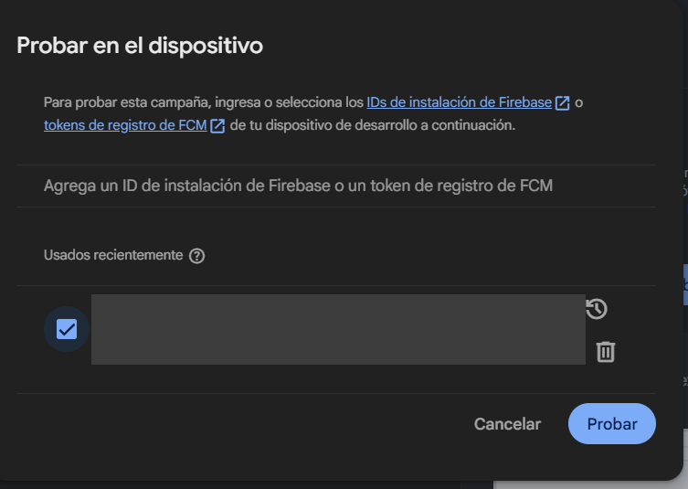
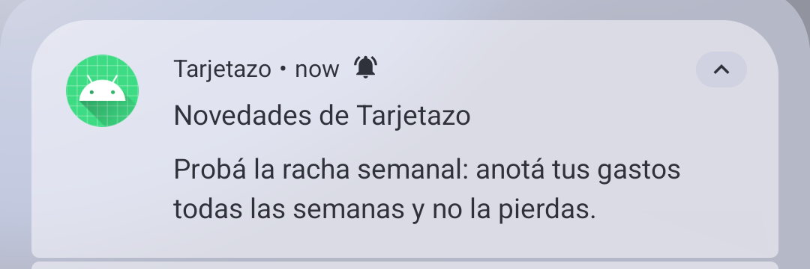
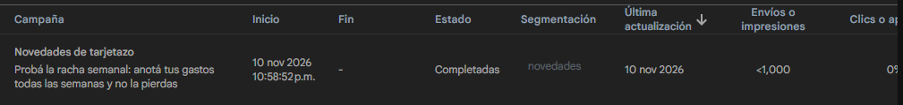
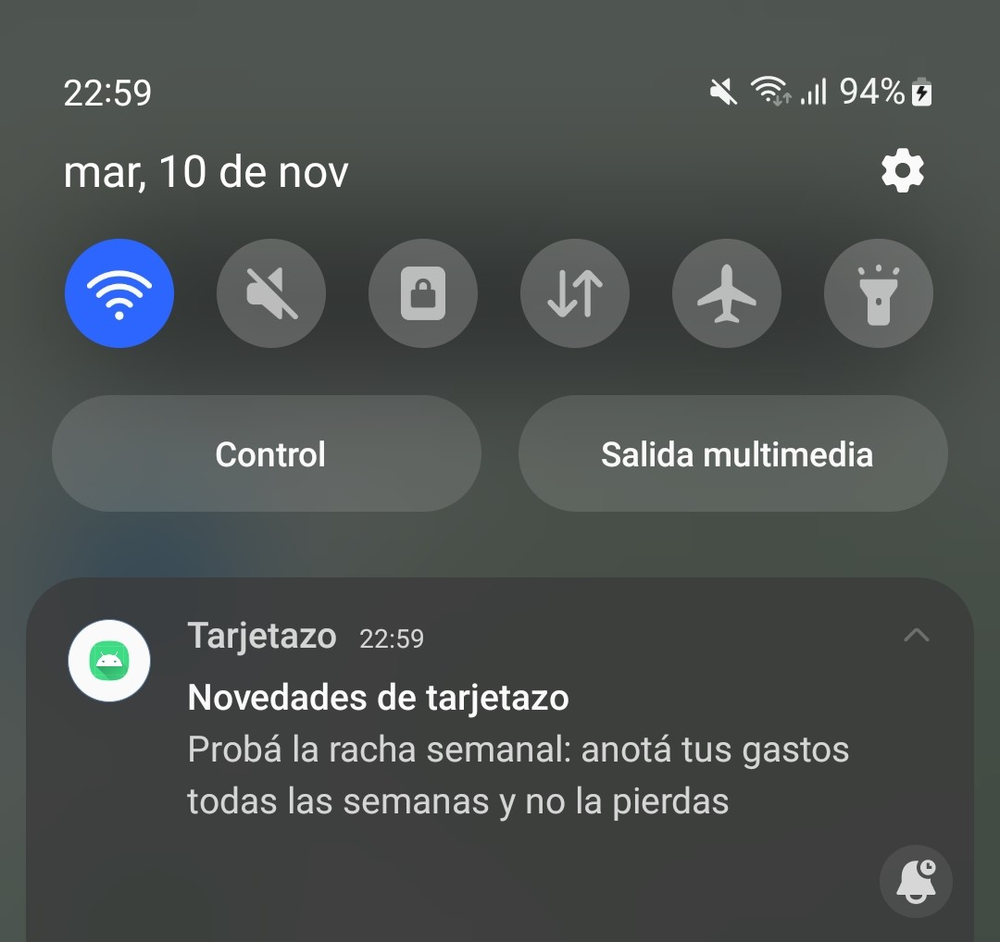
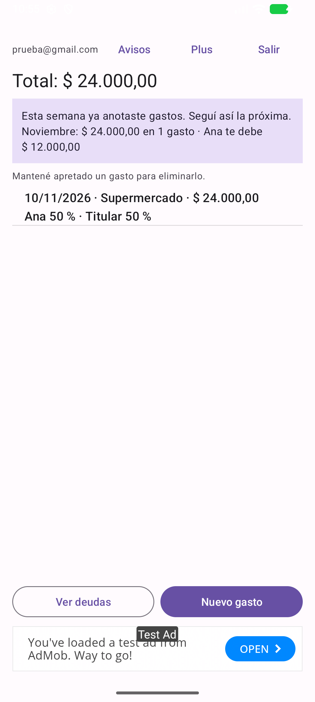
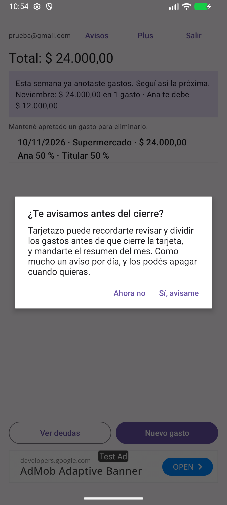
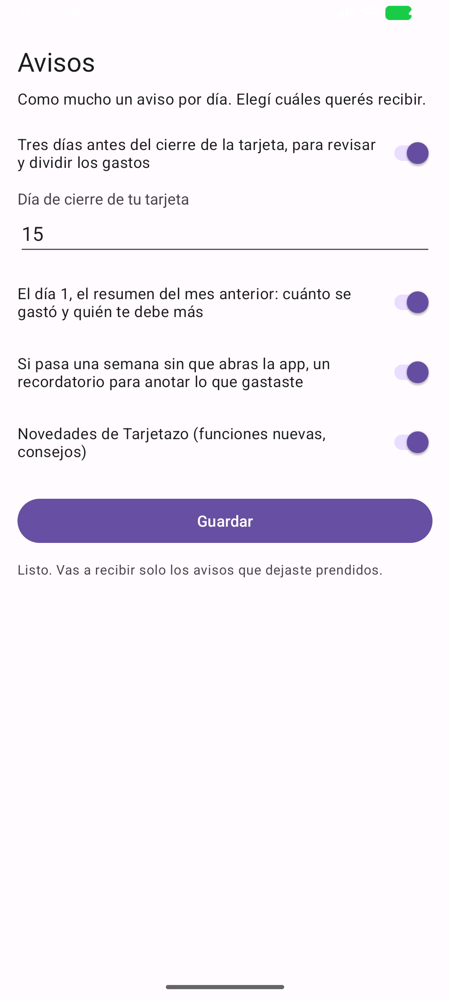
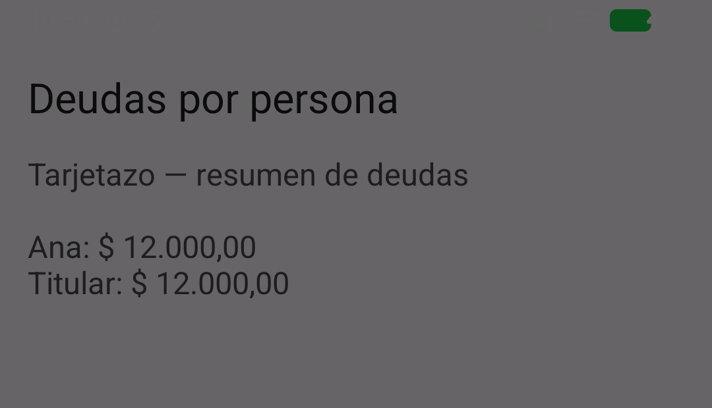
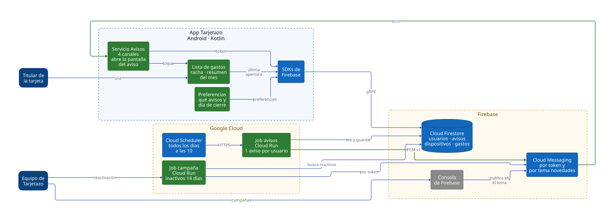

# Trabajo Práctico 6 — Estrategias de retención de usuarios

**Cátedra:** Arquitecturas Móviles — UTN Facultad Regional San Francisco
**Profesor:** Ing. Juan Pablo Bono
**Alumnos:** Martiniano Gimenez, Fabricio Quinteros
**Aplicación:** Tarjetazo — gastos de una tarjeta de crédito compartida
**Repositorio:** <https://github.com/FabriQuinteros/tp1-arquitecturas-moviles> (rama `feat/tp6-retencion`)

---

## 1. Por qué un usuario deja Tarjetazo

Conseguir que alguien instale la app cuesta mucho más que conseguir que la siga usando, y la
mayoría de las apps pierde a casi todos sus usuarios en el primer mes. Retener no es que el usuario
abra la app seguido, sino que vuelva cada vez que la app le sirve.

En Tarjetazo eso tiene una forma concreta. La app vale si **cada gasto se anota cuando ocurre**.
Si el titular se olvida de cargar dos o tres, a fin de mes el resumen no coincide con el del banco
y vuelve a reconstruir de memoria, que es justo lo que la app venía a evitar. Ahí la abandona. La
prueba con usuarios del TP 2 lo mostró: las dos participantes valoraron «centralizar los gastos»,
pero eso solo pasa si la carga se vuelve un hábito.

| Momento de riesgo | Qué pasa | Qué lo previene |
|---|---|---|
| Primera semana | Instaló, cargó un gasto y no volvió. | Que vea enseguida algo que no tenía: cuánto le deben. |
| Una semana sin abrir | Los gastos se acumulan sin anotar y empieza a parecer trabajo. | Un recordatorio a tiempo, que lleve directo a cargar. |
| Cierre de la tarjeta | Es cuando más la necesita, pero si los datos están incompletos lo frustra. | Un aviso días antes, para completar y dividir lo que falte. |
| Avisos de más | Silencia todo o desinstala. | Pocos avisos, útiles, y que cada uno se pueda apagar. |

**Cómo se mide.** Retención a 1, 7 y 30 días (de cada 100 que instalan, cuántos vuelven ese día) y,
sobre todo, el **porcentaje de semanas con al menos un gasto cargado** por usuario activo, que mide
directamente el hábito. La fecha de última apertura que guarda la app en Firestore (sección 3)
alcanza para calcular las dos.

**Qué dice la bibliografía.** El libro de la cátedra define la retención como cuántas veces los usuarios
vuelven a abrir la app en un período, y advierte que una app que no se abre al menos una vez por semana
tiene un 60 % de probabilidad de ser olvidada (van Drongelen et al., 2017, p. 374). Propone como palancas
una entrada con poca fricción, contenido nuevo y relevante, personalización, incentivos y notificaciones
push, con una condición: no hacer spam. Eso significa segmentar, cuidar la frecuencia y averiguar qué
mensajes funcionan mejor antes de automatizarlos (pp. 374–376). Las cuatro estrategias siguientes se
apoyan en esas ideas.

## 2. Estrategias

| # | Estrategia | Tipo | Qué hace | Métrica que la evalúa |
|---|---|---|---|---|
| 1 | **Avisos personalizados** | Notificaciones push | Una tarea diaria elige, para cada usuario, como mucho un aviso: tres días antes de **su** cierre, el resumen del mes el día 1, o un recordatorio si pasó una semana sin abrir la app. | Aperturas desde el aviso y semanas con carga, con aviso y sin aviso. |
| 2 | **Racha semanal** | Gamificación | La lista muestra cuántas semanas seguidas anotó gastos. La semana actual cuenta hasta el domingo, así nadie la pierde un martes. El recordatorio de inactividad la usa: «No pierdas tu racha de 4 semanas». | Largo promedio de las rachas, y si quien tiene racha abandona menos. |
| 3 | **Resumen del mes** | Contenido personalizado | La lista muestra lo gastado en el mes y quién le debe más al titular. El día 1 llega como aviso con el mes anterior. Es la respuesta a la pregunta por la que se instala la app. | Aperturas del aviso del día 1 y si después se comparte el resumen. |
| 4 | **Avisos que se pueden controlar** | Base de las anteriores | El permiso se pide después del primer gasto, con una explicación. Hay una pantalla para elegir cada tipo de aviso, un canal de Android por tipo y un tope de tres recordatorios sin respuesta. | Porcentaje que acepta el permiso y que apaga avisos. |

**Por qué estas.** El patrón de uso de una tarjeta es mensual, con un pico en el cierre, y las tres
estrategias se apoyan en ese ciclo en lugar de pelearse con él. El recordatorio genérico del TP 3 (el
mismo texto para todos, del 20 al 24) se reemplaza: cada tarjeta cierra un día distinto, y un aviso
que llega en el momento equivocado enseña a ignorar los avisos.

**Lo que se evitó a propósito.** Puntos, medallas o rankings entre usuarios: comparar cuánto gasta
cada uno no tiene sentido en una app de gastos personales y empuja a cargar datos falsos. La racha
premia el hábito, no el gasto. El libro distingue la gamificación, que da incentivos digitales como
insignias, de los incentivos reales fuera de la app, como un café de regalo (pp. 374–375). La racha es
de la primera clase y no promete premios ni compara a nadie.

## 3. Implementación de notificaciones push

Se usa **Firebase Cloud Messaging**, que ya estaba integrado desde el TP 7, ahora por dos vías:

| Vía | Para qué | Cómo llega |
|---|---|---|
| **Por token** (cada teléfono) | Avisos personalizados: el texto lleva el día de cierre, el monto del mes o la racha de esa persona. | El backend manda un mensaje por teléfono con la API HTTP v1 de FCM. |
| **Por tema** (`novedades`) | Campañas iguales para todos: una función nueva, un consejo. | Se publica una vez en el tema y Google la reparte a todos los suscriptos. |

### 3.1 En la app

- **Registro del teléfono — `Avisos.kt`.** Al abrir la app, el token de Cloud Messaging se guarda en
  `usuarios/{uid}/dispositivos/{token}`. El token es el id del documento: si llega dos veces, pisa el
  mismo. `onNewToken` lo vuelve a registrar cuando Google lo renueva, y al cerrar sesión se borra para
  que ese teléfono no reciba avisos de la cuenta.
- **Canales.** Uno por tipo de aviso: cierre, resumen, recordatorio y novedades. Desde los ajustes de
  Android se puede silenciar uno sin perder los demás.
- **Abrir donde corresponde.** Cada mensaje lleva un dato `destino`. Al tocarlo, la app entra por el
  ingreso y de ahí va a la pantalla que el aviso propone: **Deudas** para el cierre y el resumen,
  **Nuevo gasto** para el recordatorio. Un aviso que lleva a la pantalla de inicio obliga a buscar.
- **Permiso en contexto — `MainActivity.kt`.** Desde Android 13 mostrar notificaciones exige permiso.
  Antes se pedía apenas se abría la app; ahora se pide después del primer gasto, con un diálogo que
  explica para qué sirve, y si el usuario lo rechaza no se insiste.
- **Preferencias — `AvisosActivity.kt`.** Qué avisos recibir y el día de cierre de la tarjeta. Se guardan
  en `usuarios/{uid}.avisos`, que es lo que lee el backend antes de mandar nada.
- **Última apertura.** En cada `onResume` se guarda la hora del servidor en `usuarios/{uid}.ultimaApertura`.
  Con eso el backend no le manda recordatorios a quien sí usa la app.
- **Racha y resumen — `Retencion.kt`.** Funciones sin Android, probadas en `RetencionTest`, que la lista
  muestra arriba de los gastos.

### 3.2 En el backend — `retencion.py` y `tareas.py`

```python
# Todos los días a las 10, Cloud Scheduler dispara el job "avisos"
for uid, usuario, tokens in _cuentas_con_telefono(db):
    gastos = ...  # solo los de los últimos dos meses: Firestore cobra por documento leído
    aviso = retencion.elegir_aviso(usuario.get("avisos"), ultima_apertura, usuario.get("estadoAvisos"), gastos, hoy)
    if aviso:
        enviar(db, uid, tokens, aviso)   # send_each por token; borra los que Google dio de baja
```

`elegir_aviso` decide con estas reglas, probadas en `test_retencion.py`:

| Regla | Por qué |
|---|---|
| Como mucho un aviso por día y por usuario, con prioridad cierre › resumen › recordatorio | El cierre tiene fecha y no se puede postergar; el recordatorio sí. |
| El recordatorio sale a los 7 días sin abrir la app, y no más de uno por semana | Antes de una semana es normal no haber gastado nada. |
| Después de 3 recordatorios sin respuesta, se deja de insistir | Si no volvió con tres, el cuarto solo suma una razón para desinstalar. |
| Si el usuario abre la app, el contador vuelve a cero | Volvió: la estrategia funcionó. |
| El resumen solo sale si en el mes hubo gastos | Un «gastaste $ 0» no le sirve a nadie. |
| Cada aviso respeta las preferencias del usuario | Lo que se apagó, no llega. |

Los tokens que Google informa como dados de baja (`UnregisteredError`: app desinstalada, datos
borrados) se borran en el momento, así la lista no crece con teléfonos que ya no existen.

### 3.3 Reglas de Firestore y la nube

- `usuarios/{uid}`: la app puede escribir **solo** `avisos` y `ultimaApertura`. El plan de Plus (TP 4)
  y el estado de los avisos los escribe solo el backend, con credenciales de servidor.
- `usuarios/{uid}/dispositivos/{token}`: cada cuenta maneja solo sus teléfonos.
- `infra/main.tf`: el job `recordatorio` pasa a llamarse `avisos` y corre todos los días a las 10 (hora
  de Argentina). La cuenta de servicio del backend ya tenía permiso para Cloud Messaging desde el TP 3.

## 4. Campañas de notificaciones

| Campaña | Segmento | Cómo se envía | Texto |
|---|---|---|---|
| Lanzamiento de una función | Todos los suscriptos al tema `novedades` | Consola de Firebase | «Nuevo en Tarjetazo: …» |
| Reactivación | Cuentas que no abren la app hace 14 días o más y no apagaron las novedades | `python tareas.py campania "Título" "Texto" inactivos` | «Volvé a tener al día lo que te deben: cargá tus gastos de estas semanas.» |

La segmentación por inactividad la hace el backend porque la consola de Firebase solo segmenta por
comportamiento con Google Analytics, que se sacó de la app en el TP 7. La consola sigue sirviendo
para lo que llega a todos.

**Pasos en la consola de Firebase** (proyecto de Tarjetazo):

1. **Messaging → Nueva campaña → Notificaciones de Firebase.**
2. Título y texto. Para probar antes de enviar: **Enviar mensaje de prueba** con el token del
   teléfono. En la versión de desarrollo la app lo escribe en Logcat (filtro `tag:Avisos`).
3. **Destino → Tema → `novedades`.**
4. **Programación:** enviar ahora o en una fecha. Conviene un día hábil entre las 10 y las 19, no de noche.
5. **Opciones adicionales:** canal de Android `novedades` y datos personalizados `tipo = novedades` y
   `destino = nuevo_gasto`, para que al tocarla se abra la carga de un gasto.
6. **Revisar → Publicar.** La consola muestra cuántos mensajes se enviaron.

**Envío realizado.** Se armó la campaña «Novedades de Tarjetazo» en la consola y se mandó como
mensaje de prueba al token del emulador. El aviso llegó al teléfono con la app en segundo plano y lo
mostró el sistema, con el ícono y el nombre de la app:




La prueba mostró un detalle: un mensaje de la consola que no indica canal caía en un canal genérico
de Android. Se declaró `novedades` como canal por defecto en el manifiesto, así esos mensajes
quedan en el canal que el usuario puede silenciar desde los ajustes.

**Campaña publicada al tema.** Después se publicó la campaña desde la consola con destino al tema
`novedades`, sin token de por medio. En la consola figura como completada, con segmentación `novedades`
y menos de 1.000 envíos:



La recibió un teléfono real, un Samsung con Android 13 donde la app se suscribió al iniciar, y la mostró
en la barra de notificaciones con el nombre de la app y su ícono:



## 5. Pruebas

| Prueba | Resultado |
|---|---|
| Compilación (`assembleDebug`) | Compila. |
| Pruebas unitarias de la app | 19 pasan. `RetencionTest` (6): racha con huecos, racha viva hasta el domingo, varios gastos en la misma semana, resumen del mes con quién debe más, mes sin gastos y días hasta el cierre (incluido un cierre día 31 en un mes de 30). |
| Pruebas del backend (`pytest`) | 20 pasan. `test_retencion.py` (13): las mismas reglas que la app, prioridad entre avisos, recordatorio a la semana justa, tope de tres sin respuesta, reinicio del contador al volver, preferencias apagadas y segmento de reactivación. |
| Envío real con Cloud Messaging | El mensaje de prueba de la consola llegó al emulador, y la campaña publicada al tema `novedades` llegó a un teléfono real (sección 4). |
| Emulador (Android 17) | Al cargar el primer gasto aparece la tarjeta con la racha y el resumen, y el pedido de permiso con su explicación. Las preferencias se guardan. Abrir la app con `destino=deudas` lleva a Deudas, y con `destino=nuevo_gasto`, a la carga de un gasto. |






**Qué no se pudo probar.** El envío por Cloud Messaging se probó desde la consola, tanto a un token como al tema, pero la tarea
diaria que manda los avisos personalizados necesita la cuenta de servicio del proyecto y el backend
desplegado, que sigue sin desplegarse desde el TP 3. En local, sin credenciales, `tareas.py`
imprime los avisos en lugar de mandarlos. Las reglas de Firestore y
`infra/main.tf` tampoco se validaron con sus emuladores ni con `tofu validate`.

<div class="pagina-diagrama" markdown="1">

## 6. Arquitectura actualizada



Diagrama de contenedores con la notación del modelo C4: en azul lo que ya existía, en verde lo
agregado para retener y en gris los servicios de terceros. Los avisos personalizados salen de
Google Cloud: el Scheduler dispara el job diario, que lee preferencias y gastos en Firestore, elige
un aviso por usuario y se lo manda a cada uno de sus teléfonos por Cloud Messaging. Las campañas
para todos salen de la consola de Firebase hacia el tema `novedades`. En el teléfono todo entra por
el mismo servicio, `Avisos`, que lo muestra en su canal y, al tocarlo, abre la pantalla que propone.

</div>

## Bibliografía

- van Drongelen, M., Dennis, A., Garabedian, R., Gonzalez, A. y Krishnaswamy, A. (2017). *Lean Mobile App Development*. Packt.
- Cátedra Arquitecturas Móviles, UTN FRSF. *Guía de Trabajos Prácticos — Trabajo Práctico 6: Estrategias de Retención de Usuarios.*
