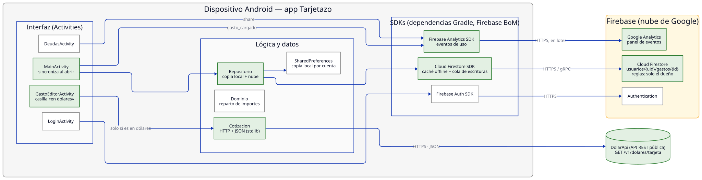

# Trabajo Práctico 7 — Integración de APIs y SDKs

**Cátedra:** Arquitecturas Móviles — UTN Facultad Regional San Francisco
**Profesor:** Ing. Juan Pablo Bono
**Alumnos:** Martiniano Gimenez, Fabricio Quinteros
**Aplicación:** Tarjetazo — gastos de una tarjeta de crédito compartida
**Repositorio:** <https://github.com/FabriQuinteros/tp1-arquitecturas-moviles> (rama `feat/tp7-apis-sdks`)

---

## 1. API y SDK: qué se integra y cómo

Una API es el contrato con que un servicio expone sus operaciones, casi siempre como un
servicio REST. Un SDK es la biblioteca que implementa ese contrato para una plataforma:
se encarga de la conexión, la autenticación, los reintentos y la conversión de datos, y
deja al código de la app una llamada de una línea. El costo es una dependencia más que
hay que mantener actualizada.

En Tarjetazo se usan las dos formas. Los servicios de Firebase entran como SDK, declarados
como dependencias de Gradle bajo una misma lista de versiones (Firebase BoM): se actualiza
un solo número y todas las bibliotecas de Firebase quedan compatibles entre sí. La
cotización del dólar entra como API REST directa, porque es una sola llamada `GET` que
devuelve un JSON y no justifica sumar una biblioteca.

Cada dependencia externa queda detrás de una sola clase (`Repositorio` para Firestore,
`Cotizacion` para la API): si mañana se cambia de proveedor, cambia esa clase y no las pantallas.

## 2. Selección

| Integración | Tipo | Qué resuelve en Tarjetazo | Por qué esta y no otra |
|---|---|---|---|
| **Cloud Firestore** | SDK de Firebase | Los gastos quedaban en el teléfono y no dependían de la cuenta: dos personas en el mismo dispositivo veían lo mismo y quien cambiaba de teléfono los perdía. Ahora se guardan por cuenta en la nube. | Ya se usa Firebase Authentication, así que la identidad del usuario sirve directo para las reglas de seguridad. Trae caché local: la carga sigue funcionando sin conexión y se sincroniza al volver la señal, que era una condición del MVP. Escala sola, sin servidores propios. |
| **Firebase Analytics** | SDK de Firebase | La prueba con usuarios del TP 2 midió dos personas una vez. Con eventos de uso la medición sigue con la app publicada: cuántos gastos se cargan, entre cuántas personas se dividen y cuántos resúmenes se comparten. | Se configura con el mismo `google-services.json`, no tiene costo y los eventos aparecen en la consola de Firebase sin construir nada. |
| **DolarApi** (`dolarapi.com`) | API REST pública | Los consumos en dólares eran un caso que el MVP dejaba afuera. El banco los cobra al “dólar tarjeta”, que ya incluye los impuestos; la app convierte el importe a ese valor del día. | Gratuita, sin clave, responde JSON simple y publica justamente el dólar tarjeta. Al no haber SDK, se consume con `HttpURLConnection` y `org.json`, que ya vienen con Android. |

## 3. Implementación

### 3.1 Dependencias

```kotlin
// app/build.gradle.kts
implementation(platform(libs.firebase.bom))   // una versión para todo Firebase
implementation(libs.firebase.auth)            // TP 2
implementation(libs.firebase.firestore)       // nuevo
implementation(libs.firebase.analytics)       // nuevo
```

Y en el manifiesto, el permiso `INTERNET` para la llamada a la API del dólar.

### 3.2 Cloud Firestore — `Repositorio.kt`

El repositorio pasa a tener dos niveles. `SharedPreferences` sigue siendo la copia local
que lee la interfaz (ahora una por cuenta) y Firestore guarda cada gasto como un documento
en `usuarios/{uid}/gastos/{id}`:

```kotlin
private val remotos = FirebaseFirestore.getInstance()
    .collection("usuarios").document(uid).collection("gastos")

fun agregar(gasto: Gasto) {
    guardar(listOf(gasto) + gastos())                         // copia local
    remotos.document(gasto.id.toString()).set(aDocumento(gasto)) // nube
}

fun sincronizar(listo: () -> Unit) {
    remotos.get().addOnSuccessListener { resultado ->
        if (resultado.isEmpty) gastos().forEach { remotos.document(it.id.toString()).set(aDocumento(it)) }
        else guardar(resultado.documents.mapNotNull { desdeDocumento(it.id, it.data) })
        listo()
    }
}
```

`MainActivity` llama a `sincronizar` al abrir: en un teléfono nuevo aparecen los gastos de
la cuenta, y la primera vez se suben los que ya estaban cargados. El importe se guarda como
texto también en Firestore, porque un número ahí sería de punto flotante y perdería centavos.
Si no hay conexión, el SDK encola la escritura y la manda solo cuando vuelve la red.

Las reglas de seguridad (`firestore.rules`) restringen cada colección a su dueño:

```
match /usuarios/{uid}/gastos/{gasto} {
  allow read, write: if request.auth != null && request.auth.uid == uid;
}
```

### 3.3 Firebase Analytics — `MainActivity.kt` y `DeudasActivity.kt`

```kotlin
FirebaseAnalytics.getInstance(this).logEvent(
    "gasto_cargado",
    bundleOf("personas" to gasto.division.size.coerceAtLeast(1).toLong(),
             "en_dolares" to enDolares.toString()),
)
// al compartir el resumen de deudas
FirebaseAnalytics.getInstance(this).logEvent(FirebaseAnalytics.Event.SHARE, null)
```

Son los dos indicadores de la hipótesis del MVP: que se carguen gastos divididos y que el
resumen se use. El SDK junta los eventos y los envía en lotes para no gastar batería.

### 3.4 DolarApi — `Cotizacion.kt` y `GastoEditorActivity.kt`

```kotlin
fun dolarTarjeta(): BigDecimal {
    val conexion = URL("https://dolarapi.com/v1/dolares/tarjeta").openConnection() as HttpURLConnection
    conexion.connectTimeout = 5_000
    conexion.readTimeout = 5_000
    try {
        if (conexion.responseCode != 200) error("La cotización respondió ${conexion.responseCode}")
        return BigDecimal(JSONObject(conexion.inputStream.bufferedReader().use { it.readText() }).getString("venta"))
    } finally { conexion.disconnect() }
}
```

En la pantalla de carga se agrega la casilla «Importe en dólares». Si está marcada, al
guardar se consulta la cotización en un hilo aparte (Android no permite red en el hilo
principal), se convierte el importe a pesos y el comercio queda anotado con el valor
usado, por ejemplo «Netflix (US$ 20 a 2028)». Si no hay conexión, el gasto no se guarda y
la app lo dice, en lugar de guardar una conversión inventada.

## 4. Pruebas

| Prueba | Resultado |
|---|---|
| Compilación del proyecto con las tres integraciones (`assembleDebug`) | Compila. |
| Pruebas unitarias del dominio y de la conversión (`testDebugUnitTest`) | Pasan. `CotizacionTest`: 20 US$ a 2028 = 40.560,00 pesos, sin perder centavos. |
| Llamada real a `GET https://dolarapi.com/v1/dolares/tarjeta` | Responde `{"moneda":"USD","casa":"tarjeta","compra":1963,"venta":2028,...}` (26/10/2026). |

## 5. Arquitectura actualizada



En verde, lo agregado en este trabajo. Cómo mejora la aplicación cada integración:

- **Cloud Firestore** convierte a Tarjetazo de una libreta en un teléfono en una cuenta: los
  gastos sobreviven al cambio de dispositivo y cada persona ve solo los suyos. Es además
  la base para la próxima funcionalidad, invitar colaboradores a la tarjeta, que es lo
  que la primera participante de la prueba llamó «centralizar los gastos».
- **Firebase Analytics** cierra el ciclo construir-medir-aprender con la app en uso real,
  sin depender de pruebas presenciales.
- **DolarApi** cubre los consumos en moneda extranjera, que en una tarjeta argentina son
  frecuentes (suscripciones, compras en el exterior), con el mismo valor que después
  cobra el banco.
